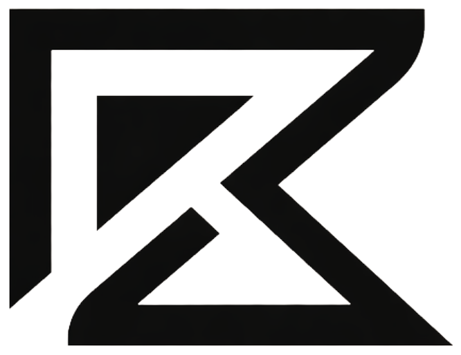

<div align="center">

<picture>
  <source media="(prefers-color-scheme: dark)" srcset="public/logo.png">
  
</picture>

# Rizky Maulana Putra - Portfolio

**Website portfolio pribadi dengan desain monokrom, animasi halus, dan tema gelap atau terang**

[]()
[]()
[]()
[]()
[]()
[]()
[]()

[Tentang](#tentang) &nbsp;|&nbsp; [Fitur](#fitur-utama) &nbsp;|&nbsp; [Memulai](#memulai) &nbsp;|&nbsp; [Mengganti Konten](#mengganti-konten)

</div>

---

## Daftar Isi

- [Tentang](#tentang)
- [Memulai](#memulai)
- [Skrip yang Tersedia](#skrip-yang-tersedia)
- [Struktur Proyek](#struktur-proyek)
- [Halaman Situs](#halaman-situs)
- [Fitur Utama](#fitur-utama)
- [Mengganti Konten](#mengganti-konten)
- [Teknologi](#teknologi)
- [Deployment](#deployment)
- [Kredit](#kredit)
- [Kontak](#kontak)
- [Lisensi](#lisensi)

---

## Tentang

Website ini adalah portfolio pribadi Rizky Maulana Putra, siswa Rekayasa Perangkat Lunak (RPL) asal Bogor, Indonesia, yang membuat website, game, aplikasi mobile, dan mod Minecraft. Isinya mencakup profil, perjalanan belajar, pengalaman, daftar skill, dan 16 project beserta tautan demo dan repositorinya.

Website dibangun dengan Next.js App Router dan seluruh kontennya terpusat di satu file, `lib/data.ts`, sehingga perubahan teks, project, atau skill tidak perlu menyentuh komponen. Grafik kontribusi GitHub di halaman Skills diambil dari profil publik dan diperbarui paling cepat satu jam sekali. Bila GitHub tidak dapat dijangkau, website memakai salinan cadangan di `lib/github-snapshot.json` sehingga halaman tidak pernah rusak.

---

## Memulai

### Prasyarat

- Node.js v18.18 atau lebih baru
- npm (bawaan Node.js) atau pnpm

### Instalasi

```bash
# Kloning repositori
git clone https://github.com/BadutZY/rizky-portofolio.git
cd rizky-portofolio

# Pasang dependensi
npm install      # atau: pnpm install
```

### Menjalankan Server Pengembangan

```bash
npm run dev
```

Website tersedia di [http://localhost:3000](http://localhost:3000).

### Build Produksi

```bash
npm run build
npm start        # menjalankan hasil build
```

Proyek ini tidak membutuhkan variabel lingkungan (environment variable) maupun API key. Semua data bersumber dari file di dalam repositori dan profil publik GitHub.

---

## Skrip yang Tersedia

| Skrip | Deskripsi |
|---|---|
| `npm run dev` | Menjalankan server pengembangan Next.js |
| `npm run build` | Membangun website untuk produksi |
| `npm start` | Menyajikan hasil build produksi |

---

## Struktur Proyek

```
rizky-portofolio/
|-- app/                      # Halaman (App Router) dan CSS tiap halaman
|   |-- layout.tsx            # Layout utama, metadata, dan font
|   |-- template.tsx          # Transisi antar halaman
|   |-- page.tsx              # Home
|   |-- about/  projects/  experience/  skills/  contact/
|   `-- not-found.tsx         # Halaman 404
|
|-- components/
|   |-- layout/               # Header, footer, intro, kursor, smooth scroll, transisi
|   |-- ui/                   # Komponen dasar (Marquee, Reveal, SplitText, Scramble, dan lainnya)
|   |-- home/  about/  experience/  contact/   # Komponen khusus tiap halaman
|   |-- pages/                # Komponen bersama (ProjectsExplorer, SkillsExplorer, ContactForm, dan lainnya)
|   `-- three/                # Badge 3D interaktif (Badge3D, Band)
|
|-- lib/
|   |-- data.ts               # Seluruh konten website
|   |-- github.ts             # Grafik kontribusi GitHub + github-snapshot.json
|   `-- ...                   # Helper animasi (gsap, motion, scramble, tilt, ascii)
|
|-- public/
|   |-- profile.jpg           # Foto profil
|   |-- projects/             # Cover dan screenshot project
|   |-- skills/               # Logo skill
|   `-- assets/               # Model 3D (card.glb) dan gambar badge
|
|-- next.config.mjs
|-- tsconfig.json
`-- package.json
```

---

## Halaman Situs

| Halaman | Alamat | Isi |
|---|---|---|
| Home | `/` | Hero, pernyataan, statistik, project unggulan, ringkasan skill dan pengalaman |
| About | `/about` | Cerita singkat, fakta, kutipan, perjalanan, minat, dan badge 3D |
| Projects | `/projects` | Daftar 16 project dengan filter, tampilan grid atau list, dan modal detail |
| Experience | `/experience` | Timeline pengalaman, pendidikan, kompetisi, dan karya yang dipublikasikan |
| Skills | `/skills` | Stack per kategori, tools, fokus belajar, dan grafik kontribusi GitHub |
| Contact | `/contact` | Kartu media sosial, peta lokasi, dan formulir kontak |

---

## Fitur Utama

| Fitur | Deskripsi |
|---|---|
| Tema Gelap dan Terang | Perpindahan tema dengan efek lingkaran (View Transitions API), otomatis beralih instan bila tidak didukung |
| Smooth Scroll | Lenis yang disinkronkan dengan GSAP ticker |
| Animasi Scroll | Parallax, kartu project bertumpuk, kata menyala saat scroll, dan timeline yang tergambar sendiri |
| Badge 3D Interaktif | Lanyard dengan fisika Rapier di halaman About, dimuat hanya saat mendekati layar |
| Penjelajah Project | Filter kategori dan perpindahan grid ke list dengan layout animation |
| Grafik Kontribusi GitHub | Data langsung dari GitHub dengan cadangan lokal |
| Kontak Dinamis | Formulir dan tombol email muncul otomatis begitu `site.email` diisi |
| Aksesibilitas | Menghormati `prefers-reduced-motion`, perangkat sentuh memakai kursor dan scroll bawaan |
| Performa | Animasi hanya memakai transform dan opacity, elemen dijeda saat di luar layar |

---

## Mengganti Konten

Hampir semua teks dan data ada di `lib/data.ts`. Komponen tidak perlu diubah.

| Yang diubah | Lokasi |
|---|---|
| Nama, role, lokasi, email, CV, status | `site` di `lib/data.ts` |
| Cerita, fakta, dan statistik About | `about` di `lib/data.ts` |
| Pengalaman, pendidikan, kompetisi, karya | `experience`, `education`, `competitions`, `published` |
| Daftar project | `projects` di `lib/data.ts` |
| Skill, tools, dan fokus belajar | `skills`, `tools`, `learning` |
| Menu navigasi dan tautan sosial | `nav` dan `socials` |
| Foto profil | `public/profile.jpg` |
| Gambar project | `public/projects/` |

Catatan penting:

- **Email**: isi `site.email` agar formulir kontak dan semua tombol email aktif. Selama kosong, pengunjung diarahkan ke media sosial.
- **CV**: taruh file di `public/` lalu isi `site.cv` (contoh `"/cv.pdf"`) agar tombol Download CV muncul.
- **Statistik**: isi `about.stats` dengan item seperti `{ value: 10, suffix: "+", label: "Projects built" }`.
- **Badge 3D**: ganti `card_dark.png`, `card_light.png`, `tag_dark.png`, dan `tag_light.png` di `public/assets/images/`. Kartu berukuran 1080x1080 (depan di kiri, belakang di kanan) dan tag berukuran 1024x248.

---

## Teknologi

| Lapisan | Teknologi | Fungsi |
|---|---|---|
| Framework | Next.js 15 (App Router) | Routing, rendering, dan optimasi |
| UI | React 19 | Antarmuka berbasis komponen |
| Bahasa | TypeScript | Pengetikan statis |
| Styling | CSS biasa dengan token | Tema gelap dan terang, satu file CSS per halaman |
| Animasi | GSAP, Anime.js v4, Motion | Scroll, urutan pembuka, dan spring physics |
| Smooth Scroll | Lenis | Scroll halus lintas halaman |
| 3D | Three.js, React Three Fiber, Drei, Rapier | Badge 3D dengan fisika |
| Hosting | Vercel | Deployment otomatis dan CDN global |

---

## Deployment

Proyek ini siap dipasang di Vercel tanpa konfigurasi tambahan.

1. Dorong repositori ke GitHub.
2. Impor proyek ke [Vercel](https://vercel.com).
3. Biarkan pengaturan bawaan (framework Next.js terdeteksi otomatis).
4. Deploy. Setiap push ke branch utama memicu deployment ulang otomatis.

Repositori menyertakan `package-lock.json` dan `pnpm-lock.yaml`. Pilih satu pengelola paket dan hapus lockfile lainnya agar Vercel tidak ambigu.

---

## Kredit

- Badge 3D diadaptasi dari [Interactive 3D Event Badge](https://github.com/daffahaidar/interactive-3d-event-badge) karya Daffa Haidar Nabil Zufar (lisensi MIT). Model `card.glb` berasal dari proyek tersebut.
- Lenis, Anime.js, dan Motion sebagai fondasi lapisan animasi.

---

## Kontak

| Platform | Tautan |
|---|---|
| GitHub | [@BadutZY](https://github.com/BadutZY) |
| Instagram | [@rzky.mp_36](https://www.instagram.com/rzky.mp_36/) |
| X | [@BadutZYY_](https://x.com/BadutZYY_) |

---

## Lisensi

Proyek ini beserta seluruh konten, foto, dan aset pribadi di dalamnya milik Rizky Maulana Putra. Seluruh hak dilindungi. Komponen pihak ketiga tetap tunduk pada lisensi masing-masing.

---

<div align="center">

**Dibuat dengan rasa ingin tahu, satu eksperimen dalam satu waktu.**

[Kembali ke Atas](#rizky-maulana-putra---portfolio)

</div>